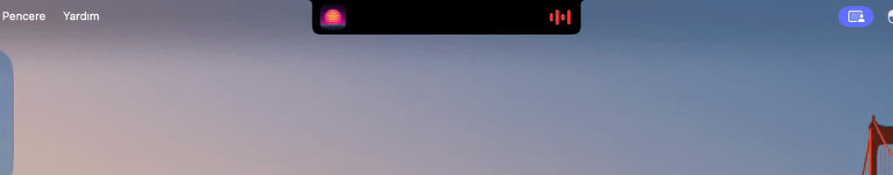

# NotchHub

[English](README.md) · **Türkçe**



MacBook çentiğini (ya da çentiksiz ekranlarda Dynamic Island benzeri bir adayı) yöneten ana uygulama.
Başka uygulamalar çentiğe kendi pencerelerini koymaz; NotchHub'a **ne göstereceklerini tarif eder**, NotchHub çizer.
Böylece birden çok uygulama çentiği aynı anda kullanır ve hiçbiri diğerinin üstüne binmez.

## Nasıl görünür

- **Kapalı:** En öncelikli etkinlik çentiğin sol ve sağ kanadında (ör. kapak + ses dalgası, ⏱ + `4:59`).
  İkinci etkinlik çentiğin sağındaki küçük baloncukta.
- **Açık:** Tüm etkinlikler yan yana kart olur (en çok 3): görsel, başlık, alt başlık, ilerleme çubuğu, düğmeler.
- **Öne çıkarma (pulse):** Bir uygulama "yeni şarkı başladı" gibi bir anı birkaç saniyeliğine açık gösterebilir.
- **Çentiksiz ekran** (harici monitör, çentiği gizleyen çözünürlük): menü çubuğunun ortasında siyah ada.

Menü çubuğu simgesi bağlı uygulamaları listeler ve **Ayarlar… (⌘,)** penceresini açar:

- **Görünüm:** açıkken en çok kart (1–4, ekrana sığacak kadar), kart genişliği, yandaki baloncuk,
  şeklin fiziksel çentiği ne kadar taşacağı ve çentiksiz ekranlarda ada gösterilip gösterilmeyeceği.
- **Davranış:** **üzerine gelince** ya da **tıklayınca** açılma, üzerine gelme gecikmesi, öne çıkarmanın süresi,
  oturum açılışında başlatma.
- **Uygulamalar:** bağlı olsun olmasın daha önce bağlanmış tüm istemciler. Birini çentikten gizle ya da
  önceliğini elle kaydır (−3…+3).
- **Hakkında:** sürüm, protokol sürümü ve soket yolu.

## Derleme ve kurulum

```bash
./build.sh            # build/NotchHub.app
./build.sh --install  # ~/Applications'a kurar ve başlatır
```

## Kendi uygulamanı bağlamak

### Swift (NotchKit)

`Package.swift`:

```swift
dependencies: [.package(path: "../NotchHub")],
targets: [.executableTarget(name: "Uygulamam",
                            dependencies: [.product(name: "NotchKit", package: "NotchHub")])]
```

```swift
import NotchKit

let notch = NotchClient(id: "com.ornek.zamanlayici", name: "Zamanlayıcı")
notch.onEvent = { e in if e.action == "stop" { /* ... */ } }

notch.update(NotchActivity(
    id: "timer", priority: 1,
    leading: .symbol("timer", tint: .orange),
    trailing: .text("4:59", tint: .orange),
    title: "Çay demleniyor",
    buttons: [NotchButton(action: "stop", symbol: "stop.fill", tint: .orange, prominent: true)],
    progress: NotchProgress(elapsed: 1, total: 300, rate: 1)))

notch.pulse("timer")   // birkaç saniye öne çıkar
notch.end("timer")     // kaldır
```

`NotchClient` NotchHub kapalıyken bekler, açılınca kendiliğinden bağlanıp son durumu gönderir.
Aynı içerik tekrar gönderilmez; ilerleme `rate` ile hub tarafında hesaplanır, her saniye güncelleme gerekmez.

### Başka diller (protokol)

Unix soketi: `~/Library/Application Support/NotchHub/hub.sock`. Her satır bir JSON mesajı.
Tam örnek: [`examples/timer.py`](examples/timer.py).

| Yön | Mesaj |
|---|---|
| → hub | `{"type":"hello","version":1,"client":{"id":"com.ornek","name":"Örnek"}}` (ilk mesaj) |
| → hub | `{"type":"activity","activity":{...}}` ekle/güncelle |
| → hub | `{"type":"end","id":"timer"}` · `{"type":"pulse","id":"timer"}` |
| hub → | `{"type":"welcome","version":1}` `hello`'ya yanıt |
| hub → | `{"type":"event","event":{"activity":"timer","action":"stop","value":null}}` |
| hub → | `{"type":"error","code":"unsupported-version","message":"..."}` ardından bağlantı kapanır |

#### Sürümleme

`hello` içindeki `version`, istemcinin yazıldığı protokol sürümüdür (şu an `1`; verilmezse `1` sayılır).
Yeni alanlar ve mesaj türleri sürüm artırılmadan, isteğe bağlı olarak eklenir; bu yüzden **tanımadığın alanları ve
mesaj türlerini yok say**. Sürüm yalnızca mevcut istemcileri bozacak bir değişiklikte artar; hub o zaman en düşük
sürümünden eski istemcileri `unsupported-version` ile reddeder. Swift'te `NotchClient.hubVersion` hub'ın sürümünü
tutar, `onError` reddi bildirir.

Etkinlik alanları (yalnızca `id` ve `title` zorunlu):

```json
{
  "id": "timer", "priority": 1, "title": "Çay", "subtitle": "4 dk kaldı",
  "leading":  {"symbol": {"_0": "timer", "tint": "orange"}},
  "trailing": {"text":   {"_0": "4:59",  "tint": "orange"}},
  "image":    {"url": {"_0": "https://..."}},
  "buttons":  [{"action": "stop", "symbol": "stop.fill", "tint": "orange", "prominent": true}],
  "progress": {"elapsed": 60, "total": 300, "rate": 1, "at": 1760800000, "seekAction": "seek"},
  "tapAction": "show"
}
```

- Kanat öğeleri: `symbol`, `text`, `image` (`{"image":{"_0":{"url":{"_0":"..."}}}}`), `bars` (`{"bars":{"animated":true}}`).
- Görseller: `url`, `symbol`, `data` (base64 PNG/JPEG).
- Renkler: `white red orange yellow green blue purple pink gray`.
- `at` Unix zamanı (saniye). `seekAction` varsa çubuğa tıklamak saniye cinsinden `value` gönderir.
- `progress` içinde isteğe bağlı `startLabel` / `endLabel` (verilmezse süre yazılır) ve `tint` (dolu kısmın rengi).
- Bağlantı kopunca o istemcinin tüm etkinlikleri kaldırılır.

## Çakışma kuralları

1. Sıralama: `priority` büyük olan önce; eşitse en son güncellenen (yalnızca ilerleme değişimi sırayı bozmaz).
2. Kapalıyken birinci kanatlarda, ikinci baloncukta; geri kalanlar yalnızca açıkken görünür.
3. Öne çıkarılan etkinlik 3 sn boyunca birinci olur ve tek kart olarak açılır.

## Hata ayıklama

`NOTCH_DEBUG=1` ile çalıştırınca bağlantılar ve olaylar terminale yazılır ve `tools/notchctl.swift` komutları
çalışır: `open`, `close`, `snapshot:/klasör`, `tap:<istemci>/<etkinlik>/<eylem>`.
`NOTCH_FORCE_ISLAND=1` çentikli ekranda da ada görünümünü zorlar.
`NOTCH_SOCKET=/yol/hub.sock` hub'ı (ve NotchKit istemcilerini) başka bir sokette çalıştırır.

`python3 tools/demo.py` ekran görüntüsü ve kayıt için uydurma verili bir sahne oynatır. Ayrı bir sokette ayrı bir
hub çalıştırdığı için gerçek istemcilerin verisi görünmez; bitince NotchHub'ı geri açar
(`--hold expanded`, `--island`, `--lang tr`; ayrıntı `--help`).

## Yapı

- `Sources/NotchKit/` — protokol türleri ve `NotchClient` (istemcilerin bağlandığı kütüphane)
- `Sources/NotchHub/HubServer.swift` — Unix soket sunucusu
- `Sources/NotchHub/HubModel.swift` — etkinlikler ve sıralama
- `Sources/NotchHub/NotchGeometry.swift` — çentik/ada ölçüleri ve yerleşim
- `Sources/NotchHub/NotchWindow.swift` — ekran başına panel, fare izleme, açılma
- `Sources/NotchHub/NotchViews.swift` — çentik şekli, kanatlar, kartlar
- `Sources/NotchHub/Settings.swift`, `SettingsView.swift` — ayarlar ve Ayarlar penceresi
